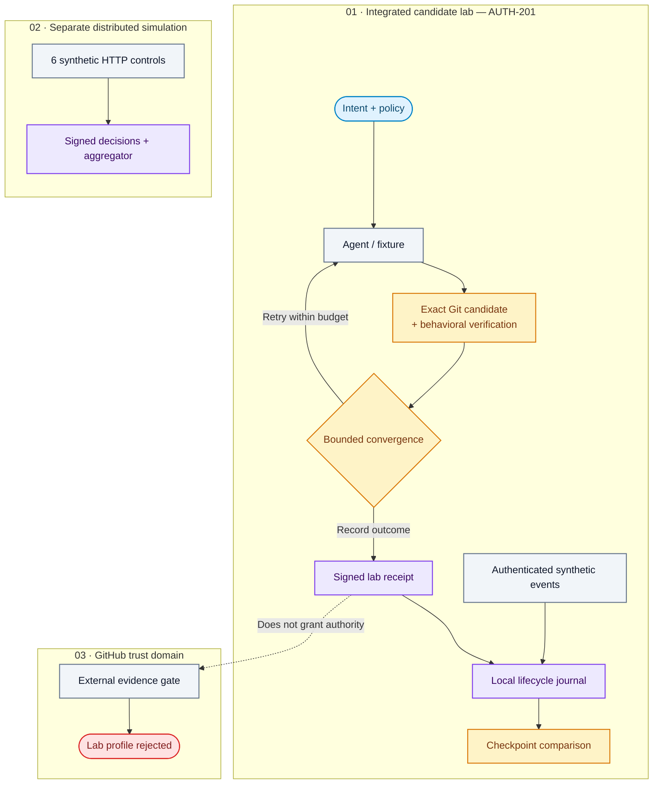
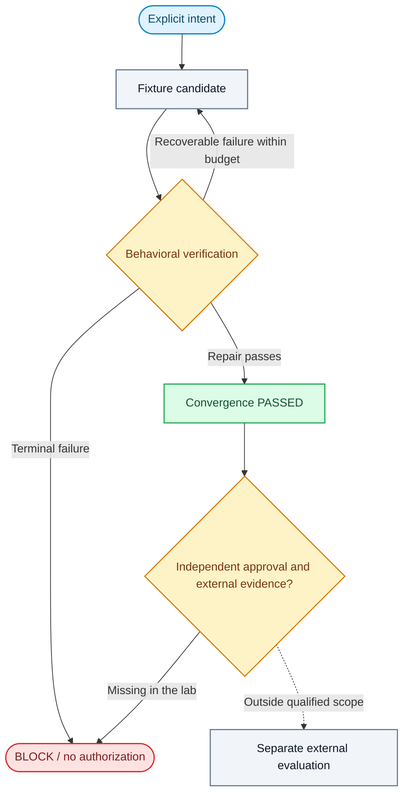

# Intent-to-Merge Governance (ITM)

**Evidence-bound, policy-governed and revocable agentic software delivery.**

[](https://github.com/brunovicco/intent-to-merge-governance/releases/tag/v1.0.0)
[](https://github.com/brunovicco/intent-to-merge-governance/actions/workflows/ci.yml)
[](https://github.com/brunovicco/intent-to-merge-governance/actions/workflows/security.yml)
[](LICENSE)
[](https://www.python.org/)
[](#trust-boundaries-and-limitations)
[](#trust-boundaries-and-limitations)

**English** · [Português (Brasil)](readme.pt-br.md) · [Release v1.0.0](https://github.com/brunovicco/intent-to-merge-governance/releases/tag/v1.0.0) · [Security](SECURITY.md)

An AI coding agent can deliver a change that passes CI while violating a business invariant, exceeding its authorized scope or lacking an independent approval. A passing build is evidence of a test result, not a grant of merge authority.

ITM is a vendor-neutral **research and reference implementation** that explores how to govern the path from an explicit intent to a candidate merge decision. It separates generation, verification, policy and lifecycle state, so that a candidate can be technically correct and still be blocked.

> Agents generate code. Evidence supports trust. Policy grants authority. Autonomy must remain revocable.

**Status** — The signed v2.0.0-rc.1 implementation completed independent AI-assisted review and local operational qualification. Publication remains on hold. [v1.0.0](https://github.com/brunovicco/intent-to-merge-governance/releases/tag/v1.0.0) remains the stable public release. `publication_ready: false`, `production_ready: false`, `merge_authority: false`.

[Migration guide](docs/migration-v2.md) · [RC qualification](docs/qualification-v2-rc1.md) · [Changelog](CHANGELOG.md).

ITM governs changes against a previously established trusted specification and verification oracle. Current verification adapters are scenario-specific; vendor neutrality does not imply domain independence.

**On this page**

[What ITM explores](#what-itm-explores) · [Who should read this?](#who-should-read-this) · [How ITM relates to existing tools](#how-itm-relates-to-existing-tools) · [Architecture](#architecture) · [Experimental results](#experimental-results) · [Quickstart — no agent credentials or paid calls](#quickstart--no-agent-credentials-or-paid-calls) · [Reproduce the studies](#reproduce-the-studies) · [Trust boundaries and limitations](#trust-boundaries-and-limitations) · [Documentation](#documentation) · [License and citation](#license-and-citation)

## What ITM explores

| Control | Question it addresses |
| --- | --- |
| Intent and scope | Does the change implement the requested behavior within authorized boundaries? |
| Provenance | Is the evidence bound to the exact Git base, head and tree? |
| Behavioral verification | Does the candidate satisfy acceptance criteria, generated properties and differential checks? |
| Convergence | Should the agent retry, stop on repeated failures or stop when its observed budget is exhausted? |
| Authorization | Are the required policy and approval conditions satisfied independently of code generation? |
| Operational autonomy | Is a decision still current, or has a lifecycle event revoked it? |

## Who should read this?

- **AI engineers and architects:** explore separation of generation, deterministic verification, and authority in coding-agent workflows.
- **Platform engineering, DevSecOps, and security teams:** experiment with candidate-bound evidence, fail-closed policy, and revocable decisions.
- **Researchers and quality engineers:** reproduce ablations, verify signed receipts, and examine control limitations.

## How ITM relates to existing tools

| Layer | Primary question |
| --- | --- |
| CI / tests | Did the change pass its configured checks? |
| Human or AI-assisted code review | Is the change understandable, appropriate, and free of issues that need review? |
| [Entire CLI](https://entire.io/about/cli) | What agent-session context is associated with the change in Git? |
| [Claude Ship](https://claude.com/resources/articles/introducing-claude-ship) | How can teams automate PR review, repair and policy-based approval? |
| **ITM (experimental)** | Does candidate-bound evidence satisfy the declared policy, and is the decision still current? |

These layers are complementary. The comparison describes their focus, not an exhaustive feature matrix. ITM does not replace CI, human review, or native branch protections. No integration with Entire or Claude Ship, or comparative tool benchmark, has been qualified.

## Architecture



The integrated runtime, distributed simulation and GitHub evidence gate are separate experimental profiles, **not a qualified end-to-end production control plane**. A lab receipt cannot authorize the external gate. See [architecture and trust boundaries](docs/architecture.md).

The repository also includes Claude Code and Codex adapters, historical signed evidence replay, multi-repository compatibility and compensation fixtures, and operational GitHub experiments.

### Decision path — AUTH-201 fixture



The second diagram depicts the fixture repair path: verification success does not authorize a merge. External evaluation is a conceptual boundary, not a positive path validated by the lab.

## Experimental results

The maintainer qualified the tree before RC preparation: 313 tests passed (full install), 312 passed and one expected skip (minimal install), identical AMGB replay, 58 reviewed Bandit findings and four classified public-key fixture findings. These results precede the version change; the exact RC requires fresh validation. See [qualification](docs/qualification-v2-rc1.md).

The published [v1.0.0 release notes](https://github.com/brunovicco/intent-to-merge-governance/releases/tag/v1.0.0) record the final local qualification and subsequent successful GitHub Actions runs on the signed release commit.

| Qualification | Observed result | Scope |
| --- | --- | --- |
| Regression suite | **224/224 passed** | Maintainer's Mac, final local candidate |
| GitHub Actions | **2/2 workflows passed** | Signed v1.0.0 commit, tests and security checks |
| Distributed control plane | **15/15 expected outcomes** | Six synthetic Compose services; 14 negative cases blocked |
| Offline decision receipt replay | **15/15 verified** | Wrong trust pin rejected; no current ALLOW at replay |
| Python dependency audit | **0 known vulnerabilities reported** | Seven audited runtime dependencies, point-in-time snapshot |
| Static analysis | 57 findings reviewed; 0 HIGH; 39 lab residuals remain | Scoped Bandit review, not absence of risk |
| Secret scan | Four public-key fixture findings reviewed; none unresolved | Gitleaks qualification, not an empty raw scan |

### Why passing CI is not enough

In the RC.3 adversarial ablation, 25 curated candidates (20 unsafe and five safe) were evaluated against progressively stronger controls:

| Cumulative strategy | Unsafe candidates accepted | Safe candidates accepted |
| --- | ---: | ---: |
| S0 — Deliberately weak CI | 20/20 | 5/5 |
| S1 — Scope and intent | 15/20 | 5/5 |
| S2 — Behavioral oracle | 10/20 | 5/5 |
| S3 — Signed synthetic controls | 0/20 | 5/5 |

A separate historical AMGB study replayed 19 signed fixed traces: unsafe accepts fell from 10/15 to 8/15, 6/15, 5/15 and finally 0/15, with all four safe traces accepted at each stage. These are distinct curated studies; do not pool their denominators or interpret them as real-world incident rates.

Live Claude Code and Codex pilots also produced passing first-attempt candidates. The RC.3 untrusted-context challenge observed no retained unauthorized marker. These small pilots do not establish model superiority, hostile-code isolation or successful live iterative repair. See [methodology](docs/benchmark-methodology.md) and [experimental results](docs/experimental-results.md).

## Quickstart — no agent credentials or paid calls

Requirements: Python 3.11+, Git and `uv` (0.12.10 was used for qualification). Use a reviewed compatible version of uv; do not resolve a new lock implicitly. Docker is needed for the optional Docker and live-agent studies, not the local fixture below.

```sh
# Use the reviewed RC checkout; do not substitute the v1.0.0 tag.
python3 scripts/release_inventory.py verify --require-lock
uv sync --locked --extra telemetry
uv run --locked python scripts/integrated_runtime.py run --fixture repair --out results/repair
```

Expected: two attempts, convergence `PASSED`, governance `BLOCK`, `merge_authority: false`. The fixture demonstrates a successful repair without granting merge authority. Use a fresh output directory for every run.

To run the full regression suite:

```sh
uv run --locked python -m unittest discover -s tests -v
```

For the signed distribution ZIP, manifest and commit identifier, see the [release assets](https://github.com/brunovicco/intent-to-merge-governance/releases/tag/v1.0.0). Verify the manifest signature against an independently trusted signer fingerprint before relying on its checksums. The release inventory checks file consistency; it is not a signature or a security attestation.

## Reproduce the studies

Run from a locked checkout after the quickstart setup. Each command uses a fresh output directory.

| Study | Command | Scope |
| --- | --- | --- |
| Historical AMGB | `uv run --locked intent-merge benchmark-replay --profile historical-v1 --bundles examples/amgb-v1/bundles --public-key examples/amgb-v1/signer.pub --output results/amgb-replay` | 19 signed curated traces |
| Adversarial ablation | `uv run --locked python scripts/adversarial_benchmark.py --out results/adversarial` | 25 curated candidates |
| Distributed control plane | `uv run --locked python scripts/control_plane.py demo --out results/control-plane` | Six synthetic controls; 15 cases |
| Integrated runtime | `uv run --locked python scripts/integrated_runtime.py run --fixture repair --out results/runtime` | AUTH-201 fixture repair |
| Journal checkpoint | `uv run --locked python scripts/journal_checkpoint.py --db results/runtime/lifecycle.sqlite` | Run after the integrated fixture; compare against a separately trusted current pin |

For Docker Compose and opt-in live agents, follow the [versioned runbooks](HISTORY.md). Do not provide production credentials or sensitive repositories to the demos.

## Trust boundaries and limitations

- No hostile-code isolation, independently administered verifier identities, real human approval withdrawal or merge-queue enforcement has been qualified.
- The lab candidate and observation worker share an interpreter. Process separation and resource-limited Docker do not establish privilege separation. Run live agents only under a disposable separate OS identity or VM without privileged credentials.
- Local journal rollback detection requires a separately trusted current checkpoint. Synthetic lifecycle events are not evidence of organizational approval revocation.
- GitHub preflight and evidence-gate checks are not atomic remote authorization; TOCTOU remains. The real lab published negative checks and updated a non-authorizing check from success to failure. No actual merge was attempted.
- Usage budgets depend on observed self-reported telemetry, not a provider hard cap or billing guarantee. Live multi-attempt repair was not demonstrated.
- The Python audit does not cover the OS, container base image or complete scanner/build toolchain. The reviewed process/PATH risks remain within the experimental scope.

## Documentation

| Topic | Reference |
| --- | --- |
| Architecture and evidence profiles | [Architecture](docs/architecture.md) |
| Benchmark design and outcomes | [Methodology](docs/benchmark-methodology.md) · [Results](docs/experimental-results.md) |
| Threat model and remaining risks | [Security review](docs/rc6-security-review.md) · [Production limitations](docs/production-limitations.md) |
| Release qualification and reproducibility | [Runbook](docs/public-release.md) · [Published release](https://github.com/brunovicco/intent-to-merge-governance/releases/tag/v1.0.0) |
| Version history and advanced demos | [History](HISTORY.md) · [Changelog](CHANGELOG.md) |
| Responsible disclosure and contributions | [Security](SECURITY.md) · [Contributing](CONTRIBUTING.md) |

Historical runbooks and evidence retain their original candidate status and qualification scope. The maintainer's publication approval is recorded in the v1.0.0 release notes; it does not retroactively change historical reports or confer production readiness.

## License and citation

Apache License 2.0 — see [LICENSE](LICENSE), [NOTICE](NOTICE) and the maintainer approval in the [v1.0.0 release notes](https://github.com/brunovicco/intent-to-merge-governance/releases/tag/v1.0.0). If citing this work, use the software version, commit and relevant experiment; see [CITATION.cff](CITATION.cff).

Independent research project, not affiliated with Anthropic, OpenAI, Entire or GitHub.
