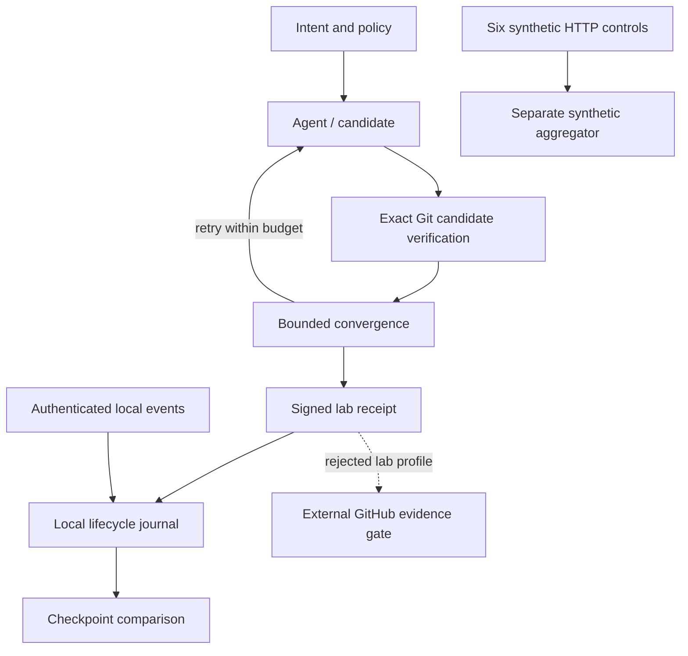

# Intent-to-Merge Governance (ITM)

**Evidence-bound, policy-governed and revocable agentic software delivery.**

Agents generate code. Evidence earns trust. Policy grants authority. Autonomy must remain revocable.

ITM is a vendor-neutral **research and reference implementation**, not a production merge service. Version 1.0.0 is a source release candidate for public qualification. The RC.6 experimental baseline passed on the maintainer's Mac; final packaging, dependency qualification, license confirmation and release signing are separate gates. `production_ready: false` and `merge_authority: false` remain unchanged in the new lab profile. The older GitHub integration is opt-in and must not be used to manufacture approvals.

## Why ITM?

A successful build is not an authorization decision. An agent can produce a candidate that passes CI while violating an intent boundary, a business invariant, or an approval policy. ITM demonstrates separate controls for specification, provenance, behavioral verification, convergence, authorization and operational autonomy, with digest-bound evidence, fail-closed policy evaluation and revocation.



The diagram depicts the integrated AUTH-201 runtime, the separate synthetic distributed plane and the separate GitHub trust domain. The three have not been qualified as a single production control plane.

## Start here — no agent credentials or paid calls

This final source candidate includes the maintainer-audited `uv.lock`. First verify the source inventory and follow [release qualification](docs/public-release.md); do not resolve a new lock implicitly. Python 3.11+ and Git are required; Docker is required for opt-in live agents.

```sh
python3 scripts/release_inventory.py verify --require-lock
uv sync --locked --extra telemetry
uv run --locked python -m unittest discover -s tests -v
uv run --locked python scripts/integrated_runtime.py run --fixture repair --out results/repair
```

Expected fixture result: two attempts, `PASSED` convergence, governance `BLOCK`, no merge authority. Use a fresh output directory each run.

## Reproduce the studies

| Study | Command after locked sync | Scope |
|---|---|---|
| Historical AMGB | `uv run --locked intent-merge benchmark-replay --bundles examples/amgb-v1/bundles --public-key examples/amgb-v1/signer.pub --output results/amgb-replay` | 19 curated signed fixtures |
| Adversarial ablation | `uv run --locked python scripts/adversarial_benchmark.py --out results/adversarial` | 25 curated candidates |
| Distributed control plane | `uv run --locked python scripts/control_plane.py demo --out results/control-plane` | Six synthetic controls; 15 cases |
| Integrated runtime | `uv run --locked python scripts/integrated_runtime.py run --fixture repair --out results/runtime` | AUTH-201 repair, signed local evidence |
| Journal checkpoint | `uv run --locked python scripts/journal_checkpoint.py --db results/runtime/lifecycle.sqlite` | Compare against a trusted external pin separately |

For live agents and Docker Compose, see the [historical runbooks](HISTORY.md). Run only under a disposable separate OS account or VM with no access to privileged credentials. The lab Docker adapter is not a proven hostile-code sandbox.

## Experimental evidence

| Study | Reported outcome |
|---|---|
| RC.6 regression (maintainer Mac) | 205/205 |
| Security-remediation candidate (maintainer Mac, pre-final edits) | 217/217; zero reported dependency advisories; 15/15 Compose |
| RC.3 synthetic adversarial ablation | unsafe accepts 20 → 15 → 10 → 0 of 20; 5/5 safe accepted |
| RC.2 live agent pilot | 10/10 first-attempt tasks |
| RC.3 live untrusted-context pilot | 10/10; no retained unauthorized marker observed |
| RC.4 Docker Compose | 15/15 expected synthetic decisions |
| RC.5 and RC.6 integrated live pilots | two first-pass candidates per release; no merge authority |
| Real GitHub lab | negative checks published; non-authorizing check updated success → failure; no merge attempted |

Results are scoped and not pooled statistical estimates. The live and Mac outcomes were reported by the maintainer, not independently re-run by the public-package builder. See [methodology](docs/benchmark-methodology.md), [experimental results](docs/experimental-results.md), and [qualification](examples/public-release/qualification.json).

## Trust and limitations

- No independent organizational verifier identities, hostile-code isolation, real approval withdrawal or merge queue enforcement has been qualified.
- The candidate and observation worker share an interpreter in the lab; process separation is not privilege separation. External checkpoint pins must be kept outside the agent trust zone.
- Token limits use observed self-reported usage; no provider hard cap or billing guarantee. Real multi-attempt repair remains unobserved.
- GitHub preflight and evidence-gate experiments are not atomic remote merge authorization. No actual merge was attempted.
- Do not run privileged GitHub probes in the agent's environment. The legacy lab scripts deliberately target the original test repository and are not a turnkey public deployment.

## Documentation

[Architecture and trust boundaries](docs/architecture.md) · [Threat model](docs/rc6-security-review.md) · [Production limitations](docs/production-limitations.md) · [Public release runbook](docs/public-release.md) · [History and feature reference](HISTORY.md) · [Security](SECURITY.md) · [Contributing](CONTRIBUTING.md)

Independent educational project, not affiliated with Anthropic, OpenAI, Entire or GitHub. See LICENSE and NOTICE for the proposed Apache-2.0 licensing; rights-holder confirmation is required before publication.
