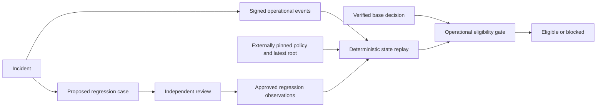

# Adaptive autonomy and incident-driven verification (v0.7)

The operational overlay adds **restrictions**, never grants merge authority. It consumes historical signed synthetic AMGB bundles and a separate operational event stream. Production GitHub enforcement is out of scope.



## Levels

- L0: circuit open; all automated release eligibility blocked.
- L1: manual release required; no automatic eligibility. A separate manual authorization workflow is not implemented.
- L2: eligible for automated orchestration **only after** the existing deterministic base policy, all approved regression gates and the configured risk ceiling pass. Never removes base approvals. In the synthetic study even high-risk changes retain Engineering and Security approvals.

A critical incident reduces level immediately to L0; a major incident reduces it to at most L1. Open incidents independently block eligibility. A verified regression failure reduces level to at most L1, and a configurable number of adverse observations in the last N outcomes also lowers the level. All proposed cases for an incident must be independently approved and passing for one candidate before governance can resolve it. Resolution moves to L1 when no incident is open; promotion to L2 requires the configured clean streak, no adverse outcomes in the current window, and a signed governance decision. Clean outcomes are deduplicated by bundle root and candidate SHA. Approved evals remain mandatory after recovery. A new candidate needs its own observations.

## Operational trust

Five distinct public keys are configured for observer, proposer, reviewer, verifier and governance roles. Each Ed25519 signature covers a domain-separated canonical event with the configuration digest, sequence, previous hash, type and payload. The stream is reconstructed deterministically; the caller supplies the expected latest root from outside the stream and pins the configuration independently. An old stream with an old anchor is not inherently detectable. The example stores a public demo anchor adjacent to the events for reproducibility; this is not a trusted production anchoring service. No private keys are included.

The scope config includes repository, agent, model, harness, policy, specification, bundle signer and profile. The gate verifies the signed bundle and the actual harness/policy/spec/signer pins. Repository, agent and model are synthetic labels attested by the operational control plane, not independently established by the AMGB bundle. A different scope or config needs its own stream and explicit trust bootstrap. No cross-scope automatic inheritance or key rotation is implemented.

| Event | Signer role | Effect |
|---|---|---|
| incident | observer | Open incident, downgrade level |
| propose_eval | proposer | Register restricted regression DSL |
| approve_eval | reviewer | Bind approved case digest |
| eval_result | verifier | Bind observations to case digest, candidate SHA and bundle root |
| resolve | governance | Close incident after required regression evidence |
| outcome | observer | Update consecutive clean count and adverse window |
| promote | governance | Explicit level increase if conditions hold |

An evaluation is a bounded list of payment operations, not executable code supplied by an incident. The trusted oracle computes expected observations. The verifier signs observations, not an allow/deny flag. Signatures authenticate claims, not their real-world truth. The demo runs trusted fixture Python; it is not a production sandbox. Outcomes and roles are simulated, and the original AMGB bundles were already merged or rejected locally. There is no automated rollback of previously merged changes, no revocation of remote approvals, no GitHub Check Run, and no claim that real incidents are prevented. The overlay is not wired into `demo` or `github-preflight` and cannot be used as a required production check in its present form.

## Reproduce

```bash
uv run intent-merge autonomy-demo --out results/autonomy-study
# Demo only: in production the root would come from an independent trusted store.
ROOT=$(python -c 'import json; print(json.load(open("examples/autonomy-v1/anchor.json"))["root"])')
uv run intent-merge autonomy-replay --config examples/autonomy-v1/config.json \
  --events examples/autonomy-v1/events.json --expected-root "$ROOT"
uv run intent-merge autonomy-gate --config examples/autonomy-v1/config.json \
  --events examples/autonomy-v1/events.json --expected-root "$ROOT" \
  --bundle examples/amgb-v1/bundles/safe-delayed --public-key examples/amgb-v1/signer.pub
```

The final gate is BLOCKED (manual release required). `ELIGIBLE` is a hypothetical result with `merge_authority: false`. `BLOCKED` is a report status, not a process exit failure; invalid evidence/configuration produces a CLI error. Integrators must explicitly inspect the status; this CLI is not an enforcement endpoint.

The fresh study produces different signing keys and root. Replaying the shipped stream reproduces its exact final state. The 13-stage example demonstrates L2 → L0 → L1 → L2 → L1, stale regression evidence, base policy denial and automatic downgrade. A separate faulty fixture passes 37 original cases but fails the incident-specific case. These are designed synthetic outcomes, not statistical evidence of production safety or an extension to the AMGB v1 rate calculation.
