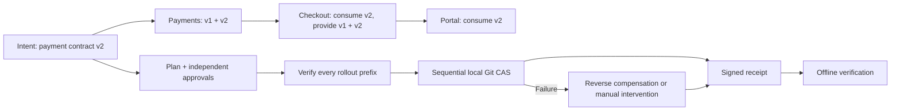

# Multi-repository change sets (v0.8)

An intent can span several repositories. A compatible final state alone does not guarantee a safe rollout. ITM v0.8 checks declared compatibility at the starting state and at every intermediate state of a provider-first topological merge order.



## Contract model

Each local bare fixture repository stores a `contract.json` at its base and candidate commits. `provides` lists supported contract version identifiers; `requires` maps every declared dependency to exactly one supported version. The trusted configuration specifies dependencies, allowed paths and one independent reviewer public key per component, plus an executor public key. Contract declarations are not behavioral API tests. The current implementation intentionally restricts itself to one deterministic provider-first order and rejects cycles; it does not search for alternative valid orders.

A candidate must be a nonempty fast-forward change inside its allowed paths. Both endpoints of a rename are checked by disabling rename detection in the Git diff. The plan binds exact base/head commits, observed paths, contract declarations, topological order and compatibility results to the configuration digest. Every reviewer signs the entire plan digest and its component identity. Any changed plan invalidates those approvals. The signer for execution receipts is separate from the component reviewers.

## Local execution and failure semantics

The executor rederives the plan from the local bare repositories before any writes. Before each sequential update it compares the main refs with the expected state and checks the candidate ref, then uses `git update-ref <ref> <new> <old>` for a compare-and-swap on the individual repository. A controlled failure triggers reverse-order compensation of previously changed refs. Compensation is attempted only when the observed main refs still match the expected state; an unexpected external ref movement stops compensation instead of overwriting it.

| Outcome | Meaning |
|---|---|
| COMPLETED | All expected local main refs were advanced. |
| BLOCKED | Plan or approval validation failed before coordinator writes. |
| ABORTED | An execution failure occurred before any successful update. |
| COMPENSATED | Earlier local ref updates were restored in reverse order. |
| MANUAL_INTERVENTION | Observed ref drift or failed compensation requires intervention. |

This is **not** a distributed transaction or crash-safe saga. A process crash, Git outage, or concurrent writer between cross-repository checks can leave partial state or prevent receipt generation. CAS protects the particular ref being updated, not every other repository atomically. Ref restoration is not deployment rollback, data migration reversal, or reversal of external side effects. A production design would need a durable write-ahead journal, repository identity binding, coordination/leases, independently verified API behavior, deployment gates, and forward recovery. The local fixture API is not connected to GitHub or the v0.7 live-eligibility overlay, and grants no remote merge authority.

## Evidence and replay

The execution receipt contains the plan, Ed25519 component approvals, a hash-chained execution journal, final status and executor signature. `changeset-verify` accepts a trusted config digest supplied separately and verifies the signature, plan derivation, approval bindings, event sequence and terminal state without access to Git. This proves the recorded decisions and observations are internally consistent and authenticated by the configured identities; it does not independently establish the truth or freshness of Git observations. The included demo anchor is only a fixture, not a production trust service. The existing v0.4 in-toto bundle and v0.7 operational event stream are unchanged; the change-set receipt is a separate signed format, not an in-toto attestation.

## Reproduce

```bash
uv run intent-merge changeset-demo --out results/changeset-study
ROOT=$(python -c 'import json; print(json.load(open("examples/changeset-v1/anchor.json"))["config_digest"])')
uv run intent-merge changeset-verify --config examples/changeset-v1/config.json \
  --receipt examples/changeset-v1/compatible/receipt.json --expected-config-digest "$ROOT"
uv run python -m unittest discover -s tests -p test_changeset.py -v
```

The sample includes only public keys, plans, signed receipts for executed scenarios and a report. Fresh runs generate local bare Git repositories and new keys. The synthetic fault hooks are not exposed as live integrations. For blocked scenarios, the sample plan/report is illustrative evidence, not a signed execution receipt. Compatibility flags describe the *planned* sequence, not the observed state after a simulated external conflict.
