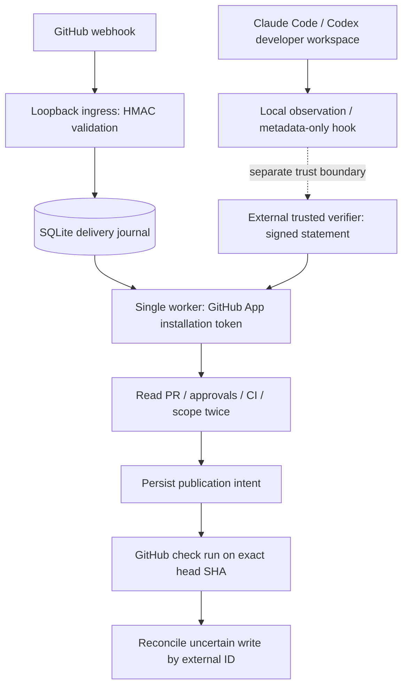

# v0.9 — operational integration reference

## Trust boundaries



The verifier in this diagram is an **external responsibility**, not a live implementation of all ITM controls. Synthetic bundles, local agent metadata and the v0.7 simulated autonomy stream do not authorize real PRs. The external verifier must independently evaluate the exact candidate and supply trustworthy evidence; this release verifies its signed assertion and digest, not the evidence behind that digest. A signed statement is not proof of code correctness.

## Configure a GitHub App (operator-owned)

Create a GitHub App with repository permissions Contents: read, Pull requests: read, Checks: read/write; subscribe to Pull request and Pull request review events. Install it only on the intended repository. No contents write, no remote merge endpoint. Set a high-entropy webhook secret. Set the repository, app IDs for trusted checks and reviewer user IDs in a **trusted** copy of `examples/github-policy.toml`, outside the PR workspace. Pin the app as the check producer in GitHub rulesets if experimenting with additional checks; do not use this snapshot gate as a sole merge control. Keep native branch protection, independent required reviews and up-to-date branch requirements. Merge queue, expiry invalidation, check-run refresh on all events, review race handling and full live verifier integration remain future work.

Run on POSIX with a service-owned directory (mode 0700), shared between ingress and worker, outside candidate workspaces. Ingress is a reference HTTP server bound to loopback; use a hardened HTTPS reverse proxy with request/connection limits and no exposure of the worker. Give ingress only the webhook secret (at least 32 bytes), not the App private key. Worker gets the private key and trusted policy/public verifier key, not the webhook secret. Provision separate OS identities or services and restrict access to the database. No private keys are included.

```bash
uv sync --extra telemetry
# ingress: set ITM_WEBHOOK_SECRET through a secret manager
uv run itm-ops serve --db /trusted/jobs.sqlite --repo OWNER/REPO --installation 123
# trusted operator can also request a refresh after CI, verifier assertion or base changes
uv run itm-ops refresh --db /trusted/jobs.sqlite --repo OWNER/REPO --pr 42
# one queued job, dry-run by default; use a separate test queue for dry runs
uv run itm-ops worker --db /trusted/jobs.sqlite --policy /trusted/github-policy.toml \
  --app-id 789 --installation 123 --app-key /trusted/app.pem \
  --assertions /trusted/assertions --verifier-key /trusted/verifier.pub --trace-console
# add --publish only after reviewing configuration in a test repository
```

The worker mints a short-lived RS256 App JWT, exchanges it for a repository-scoped installation token and never logs either. IDs above are placeholders. `--publish` posts a check; it never merges. The service is not deployed or authenticated by the release tests. A supervisor can invoke the one-shot worker repeatedly. On error before publication the job is queued for retry; avoid a tight retry loop and use operator-managed backoff/dead-letter handling. Dry-run consumes that job; refresh creates a new one.

## External verifier assertion contract

File `/trusted/assertions/42-HEAD_SHA.json`, Ed25519 envelope `{ "statement": {...}, "signature": "base64..." }`. The external signer signs `b"ITM-live-verifier-v1\\x00" + canonical(statement)` (canonical JSON is the existing `intent_merge.core.canonical` function; the domain uses an actual NUL byte). Required statement fields:

- `schema_version: 1`, `profile: "live-external-verifier"`.
- `repository`, `pr`, `head`, `base`, `policy_digest`: exact preflight binding.
- `issued_at`, `expires_at`: Unix seconds, maximum 900-second lifetime.
- `controls`: boolean true for `intent`, `provenance`, `verification`, `convergence`, `authorization`, `operational_autonomy`.
- `evidence_digest`: SHA-256 reference to external evidence.

The worker rejects missing, stale, invalidly signed, mismatched or incomplete statements. It compares two fresh snapshots before publication. The signer is explicitly trusted to check underlying evidence and must not be accessible by coding agents. Do not use fixture keys or sign unverified inputs. The local fixture study uses an ephemeral key and an in-memory fake API solely to exercise this contract.

**Important limitation:** check runs are attached to a commit SHA, not a permanent PR/base-specific authorization lease. A successful check can become stale after publication (review dismissal, expiry, base update, another PR sharing the same SHA). This release does not implement automatic revocation on every event or atomic merge-time enforcement. Do not use it as a production authorization service. Maintain independent required controls and revalidate at the actual enforcement boundary.

## Persistent recovery

`QUEUED → RUNNING → PUBLISHING → DONE`. A dry run ends in `DRY_RUN`. On process restart `RUNNING → QUEUED` and `PUBLISHING → UNCERTAIN`. The SQLite transaction commits publication intent before making the network call. An uncertain write is never automatically reissued; reconcile by exact external ID, app, head, name and conclusion. A zero/multiple match result stays uncertain.

```bash
uv run itm-ops journal --db /trusted/jobs.sqlite
uv run itm-ops reconcile --db /trusted/jobs.sqlite --policy /trusted/github-policy.toml \
  --app-id 789 --installation 123 --app-key /trusted/app.pem --delivery DELIVERY_ID
```

This is local durable job recovery, not distributed exactly-once delivery or v0.8 multi-repository crash recovery. A trusted operator must handle unresolved publication, missed deliveries, database backups, queue retention and availability. The journal is not a cryptographically authenticated event store.

## Local agent execution and hooks

Run on a dedicated development machine/workspace (not on the App worker). Install and authenticate the official agent CLI separately; configure its normal sandbox/permissions. The wrapper uses Claude `-p --output-format stream-json --verbose` or Codex `exec --json --sandbox workspace-write`, without bypassing approval settings. It captures a clean starting HEAD and a post-run Git snapshot, including tracked diff digest and porcelain status digest. It does not commit or push changes. Untracked contents are not attested. The session stream is temporarily written to a private temp directory, normalized and removed on normal exit; secure deletion and crash cleanup are not guaranteed. Prompt text is passed to the local process as an argument; use only non-sensitive prompts. It removes ITM-prefixed environment variables, not all possible credentials; the wrapper is not a sandbox.

```bash
uv run itm-ops agent-run --provider codex --repo /work/dedicated-repo \
  --prompt-file /work/approved-spec.txt --output /work/codex-observation.json
# use --provider claude for Claude Code
# generic hook adapter (wire as a command hook in your installed CLI):
uv run itm-ops hook --provider claude --repo /work/dedicated-repo \
  --output /work/session-start-unique.json < hook-event.json
```

Hook expects `hook_event_name` (`SessionStart`, `SessionEnd`, `Stop`) and `session_id` or `thread_id`; only hashed session identity and local Git snapshot are retained. Use distinct output paths outside the workspace per invocation; do not install hooks controlled by candidate code. Native hook configurations vary by CLI version, and no native CLI hook invocation was tested (the runner was tested with local fake executables). The runner and hook do not produce an independently attested candidate or call the external verifier.

## Telemetry

Install the `telemetry` extra. `--trace-console` exports OpenTelemetry spans to stderr (`itm.worker`, `itm.evaluate`, `itm.publish`), with a bounded decision attribute. No raw prompt, token or webhook body is included. The journal stores report metadata (including repository paths); protect it as internal data. Collector/OTLP infrastructure is not deployed. Programmatic workers can inject their own tracer.

## References

- GitHub App installation tokens: https://docs.github.com/en/apps/creating-github-apps/authenticating-with-a-github-app/generating-an-installation-access-token-for-a-github-app
- GitHub webhook validation: https://docs.github.com/en/webhooks/using-webhooks/validating-webhook-deliveries
- Codex noninteractive execution: https://developers.openai.com/cookbook/examples/codex/build_iterative_repair_loops_with_codex

### GitHub check collection limits

Preflight and publication reconciliation request `filter=all` for the exact commit SHA. Preflight selects the highest check-run ID for the required name, App and head. Reconciliation checks for multiple records carrying the publication's external ID, including older runs. Both require consistent counts and distinct, structurally valid identities across up to 30 pages of 100 runs. A nullable App cannot qualify as a trusted producer.

Before listing runs, ITM probes the unfiltered check-suite count and rejects refs that advertise 1,000 or more suites. GitHub limits the ref-level run endpoint to the most recent 1,000 suites and may delete older same-name runs within a suite. This procedure validates the collection GitHub exposes to the configured credentials under those limits. Stable counts and distinct IDs do not establish an atomic snapshot, and concurrent changes that preserve counts may go undetected. Count changes and invalid responses stop evaluation with a recoverable observation error. Reconciliation retains the original publication identity so operators can retry observation without repeating the creation POST.

[GitHub check runs](https://docs.github.com/en/rest/checks/runs) · [GitHub check suites](https://docs.github.com/en/rest/checks/suites)
