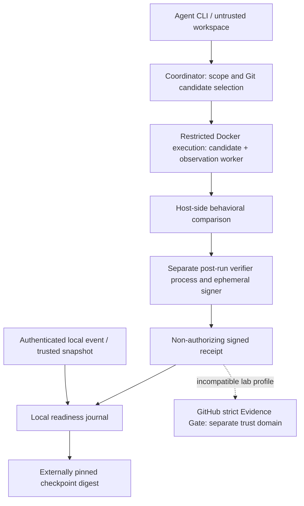

# RC.6 security review and release qualification

Status: research/reference candidate, **production HOLD**. This is a scoped internal review, not a third-party penetration test or certification. The RC.6 hardening is confined to the integrated AUTH-201 profile; the historical payment verifier remains byte-identical so signed corpus provenance and replay do not change. Do not run legacy or integrated executors on hostile inputs outside a disposable lab.

## Trust boundaries and assets

Protected assets: policy, intent spec, exact Git base/head/tree, test plan, observations, signer private keys and trust inventory, local event secret, journal, GitHub App private key and remote checks. The agent runs under the invoking user's privileges; no privilege boundary separates its OS account from the coordinator. Process separation and Docker constraints reduce exposure but do not establish trust in the candidate's behavior or the observation channel. The signing process must be separately administered and unable to consume attacker-controlled scripts or paths in a real deployment.

## STRIDE + agent-specific risk register

| ID | Threat / boundary | Current control and RC.6 evidence | Residual risk / qualification |
|---|---|---|---|
| T01 | Spoofed Git candidate (S/T) | Disable Git replace refs and inherited GIT_* configuration in integrated Git wrapper; verify fixture tree inventory and ancestry; compare prior attempt source/tree with independent re-evaluation | Same-user Git metadata, local config, binary PATH and TOCTOU remain untrusted; no remote candidate guarantee |
| T02 | Forged or stale receipt (S/T) | Dedicated Ed25519 lab domain, pinned public key, artifact and convergence digests, 60s freshness | Trusted signer can lie; local public pin is not independently administered; receipt cannot authorize merge |
| T03 | Revocation-before-registration / new receipt resurrection (T/E) | Transactional permanent denials for review/circuit events; pending binding-change fence; monotonic snapshot check; new RC6 tests | Single-candidate journal, no recovery authorization protocol; HMAC sender/clock is trusted; event ordering not global |
| T04 | SQLite edit, deletion or rollback (T/R) | Consistent logical checkpoint over tables, compare with externally held latest digest; tamper and stale-pin probes | Local digest alone proves nothing; external monotonic storage, signing and fencing not deployed; no automatic remote revocation |
| T05 | Excessive worker output or hanging process (D) | Bounded POSIX stdout/stderr capture and deadline, process-group cleanup, existing Docker cleanup | Docker daemon, descendants escaping process group, Git outputs and storage exhaustion remain separate risks |
| T06 | Hostile candidate falsifies observations (T/E) | Structural checks and host oracle; no network, read-only container, non-root, dropped capabilities | Candidate shares interpreter with observation worker; malicious code can influence observation; not qualified for hostile execution |
| T07 | Prompt injection / unauthorized scope (E) | Harmless marker challenge, scope and structural controls, fail-closed candidate acceptance | Agent same-user side effects, temporary/hidden edits and external actions not comprehensively observed |
| T08 | Agent steals keys or modifies verifier (I/E) | Ephemeral signing key created after agent invocations; restricted mounts; secret env filtering | Same-account agent could persist or access files; require separate OS identity/VM, independent signer and externally pinned code |
| T09 | Webhook replay / service spoofing (S/T) | HMAC ingress in older operational path, local event ID deduplication, nonce-bound synthetic RC4 receipts | RC4 HTTP is private but unauthenticated transport; no mTLS or deployed workload identities; webhook ordering and fencing pending |
| T10 | Remote check stale between evaluation and merge (T/E) | Exact SHA and app identity checks, repeated snapshot and sweep, tested negative publication | Non-atomic TOCTOU; merge queue processing and real positive approval/revocation not qualified |
| T11 | Supply-chain compromise (T/E) | Build/test dependency declarations and release inventory | No verified vulnerability scan, full transitive SBOM, signed release or pinned CI action revisions in RC6 |
| T12 | Budget overshoot / false usage (D/R) | Observed provider-specific token and attempt budget; stop on missing telemetry | Self-reported usage; no provider hard caps, real iterative repair not observed, overhead outside agent budget |

S = spoofing; T = tampering; R = repudiation; I = information disclosure; D = denial of service; E = elevation of privilege.

## Journal semantics (ADR-006)

- RC6 uses schema v2. Older RC5 journals are rejected; preserve them as historical evidence rather than silently migrating missing event payloads.
- Review withdrawal and circuit-open permanently deny a head/base binding in this single-candidate lab, including events arriving before registration and freshly signed receipts for that binding. No recovery action is offered. A binding-change event fences new registrations pending a strictly newer trusted snapshot and revokes known incompatible bindings. Reconcile rejects older or equal-time conflicting snapshots; expiry revokes existing receipt IDs. A fresh receipt after expiry alone may be registered if not otherwise denied.
- Registration, event processing and reconciliation use SQLite write transactions. State reads are stored state, not current authority; reconcile against a trusted head/base and clock before consuming readiness. The journal has no merge authority.
- Checkpoint pins are compared outside the agent trust zone. Pin the latest digest in separately controlled, rollback-resistant storage; a locally stored digest can be replaced together with the database. A matching digest indicates equality to that snapshot, not semantic correctness or a live lease. Legitimate transitions also change it.
- The event source's HMAC secret and clock remain trusted; stale review events may deny rather than restore. No distributed lock, event ordering or external checkpoint service is claimed.

## Qualification gates before any production use

1. Independent identities/keys and deployment boundaries for all six real controls, trusted artifact inputs and signer-only privileges; mutual service authentication and key rotation.
2. Isolated candidate process/VM and externally validated observation protocol, hard resource quotas, independent adversarial isolation test. No credentials or control-plane access from candidate or agent.
3. Durable externally anchored journal, concurrency/fencing, crash recovery and lost-event reconciliation with real remote state; live revocation of a legitimately authorized check, independent human approval and merge-group candidate enforcement.
4. Reproducible dependency lock, full transitive SBOM and vulnerability/SAST audit with reviewed findings; pin CI images/actions and establish release signing/provenance.
5. Broader live trials with pinned model/version, randomized paired baseline/challenge, real repair trajectories and cost/latency measurement; independent review of benchmark design.

The current repository is suitable for educational, synthetic and opt-in disposable lab demonstrations only. Publishing as a reference implementation is a separate decision from granting production authority.
