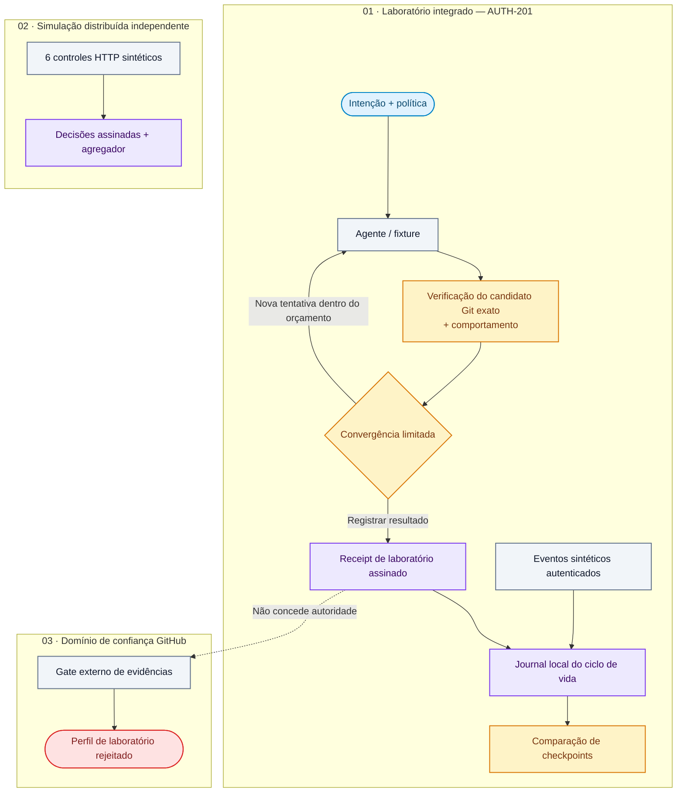
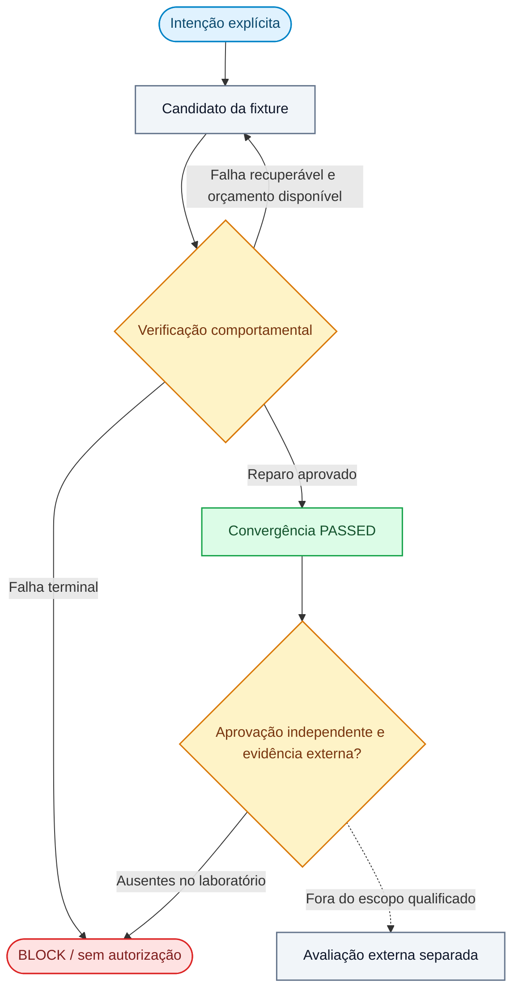

# Intent-to-Merge Governance (ITM)

**Entrega de software com agentes de IA vinculada a evidências, governada por políticas e com autonomia revogável.**

[](https://github.com/brunovicco/intent-to-merge-governance/releases/tag/v1.0.0)
[](https://github.com/brunovicco/intent-to-merge-governance/actions/workflows/ci.yml)
[](https://github.com/brunovicco/intent-to-merge-governance/actions/workflows/security.yml)
[](LICENSE)
[](https://www.python.org/)
[](#fronteiras-de-confiança-e-limitações)
[](#fronteiras-de-confiança-e-limitações)

[English](README.md) · **Português (Brasil)** · [Release v1.0.0](https://github.com/brunovicco/intent-to-merge-governance/releases/tag/v1.0.0) · [Segurança](SECURITY.md)

Um agente de programação pode entregar uma alteração que passa na CI, mas viola uma regra de negócio, ultrapassa o escopo autorizado ou não possui uma aprovação independente. Uma build bem-sucedida é evidência de um resultado de teste, não uma autorização de merge.

O ITM é uma **implementação de pesquisa e referência**, independente de fornecedores, que explora como governar o caminho entre uma intenção explícita e a decisão sobre um possível merge. O projeto separa geração, verificação, políticas e estado do ciclo de vida, de modo que uma alteração tecnicamente correta ainda possa ser bloqueada.

> Agentes geram código. Evidências sustentam a confiança. Políticas concedem autoridade. A autonomia precisa ser revogável.

**Status:** candidato v2.0.0-rc.1, ainda não publicado. A [v1.0.0](https://github.com/brunovicco/intent-to-merge-governance/releases/tag/v1.0.0) continua sendo a release pública de referência. `production_ready: false`; `merge_authority: false`.

[Guia de migração](docs/migration-v2.md) · [Qualificação da RC](docs/qualification-v2-rc1.md) · [Changelog](CHANGELOG.md).

O ITM governa alterações a partir de uma especificação e de um oráculo previamente definidos e confiáveis. Os verificadores atuais são específicos dos cenários experimentais; a neutralidade de fornecedor não implica generalidade de domínio.

**Navegação**

[O que o ITM explora](#o-que-o-itm-explora) · [Para quem é o ITM?](#para-quem-é-o-itm) · [Como o ITM se diferencia](#como-o-itm-se-diferencia) · [Arquitetura](#arquitetura) · [Resultados experimentais](#resultados-experimentais) · [Início rápido — sem credenciais de agentes ou chamadas pagas](#início-rápido--sem-credenciais-de-agentes-ou-chamadas-pagas) · [Reproduzir os estudos](#reproduzir-os-estudos) · [Fronteiras de confiança e limitações](#fronteiras-de-confiança-e-limitações) · [Documentação](#documentação) · [Licença e citação](#licença-e-citação)

## O que o ITM explora

| Controle | Pergunta que busca responder |
| --- | --- |
| Intenção e escopo | A alteração implementa o comportamento solicitado dentro dos limites autorizados? |
| Proveniência | As evidências estão vinculadas à base, ao head e à árvore Git exatos? |
| Verificação comportamental | A alteração atende aos critérios de aceitação, propriedades geradas e testes diferenciais? |
| Convergência | O agente deve tentar novamente, interromper diante de falhas repetidas ou parar ao atingir o orçamento observado? |
| Autorização | As condições de política e aprovação são satisfeitas independentemente da geração de código? |
| Autonomia operacional | A decisão continua vigente ou foi revogada por um evento do ciclo de vida? |

## Para quem é o ITM?

- **Engenharia e arquitetura de IA:** investigar como separar geração, validação determinística e autoridade em fluxos com agentes de código.
- **Platform Engineering, DevSecOps e segurança:** experimentar evidências vinculadas ao candidato, políticas fail-closed e revogação de decisões.
- **Pesquisa e engenharia de qualidade:** reproduzir ablações, verificar receipts assinados e discutir os limites dos controles.

## Como o ITM se diferencia

| Camada | Pergunta principal |
| --- | --- |
| CI / testes | A alteração passou nas verificações configuradas? |
| Code review humano ou assistido por IA | A alteração é compreensível, adequada e contém problemas que precisam de revisão? |
| [Entire CLI](https://entire.io/about/cli) | Qual contexto de sessão do agente está associado à mudança no Git? |
| [Claude Ship](https://claude.com/resources/articles/introducing-claude-ship) | Como automatizar revisão, correção e aprovação de PRs segundo a política da equipe? |
| **ITM (experimental)** | As evidências vinculadas ao candidato satisfazem a política definida, e a decisão continua vigente? |

As camadas são complementares. A comparação descreve seus focos, não uma matriz exaustiva de funcionalidades. O ITM não substitui CI, revisão humana ou controles nativos de proteção de branches. Não foram qualificadas integrações com Entire ou Claude Ship nem realizados benchmarks comparativos entre ferramentas.

## Arquitetura



O runtime integrado, a simulação distribuída e o gate de evidências do GitHub são perfis experimentais distintos, **não um plano de controle de produção qualificado de ponta a ponta**. Um comprovante do laboratório não pode autorizar o gate externo. Veja [arquitetura e fronteiras de confiança](docs/architecture.md).

O repositório também inclui adaptadores para Claude Code e Codex, replay de evidências históricas assinadas, fixtures de compatibilidade e compensação entre repositórios e experimentos operacionais no GitHub.

### Fluxo de decisão — fixture AUTH-201



O segundo diagrama representa o caminho de reparo da fixture: passar na verificação não equivale a autorização. A avaliação externa é uma fronteira conceitual, não um caminho positivo validado pelo laboratório.

## Resultados experimentais

A árvore anterior à preparação desta RC foi qualificada pelo mantenedor com 313 testes aprovados (instalação completa), 312 aprovados e um skip esperado (mínima), replay AMGB idêntico, 58 achados Bandit revisados e quatro achados de chaves públicas de fixture classificados. São resultados anteriores à mudança de versão; a RC exata ainda precisa de nova validação. Veja [qualificação](docs/qualification-v2-rc1.md).

As [notas da release v1.0.0](https://github.com/brunovicco/intent-to-merge-governance/releases/tag/v1.0.0) registram a qualificação local final e as execuções posteriores bem-sucedidas do GitHub Actions no commit assinado da release.

| Qualificação | Resultado observado | Escopo |
| --- | --- | --- |
| Suíte de regressão | **224/224 testes passaram** | Mac do mantenedor, candidato local final |
| GitHub Actions | **2/2 workflows passaram** | Commit assinado da v1.0.0, testes e verificações de segurança |
| Plano de controle distribuído | **15/15 resultados esperados** | Seis serviços sintéticos no Compose; 14 casos negativos bloqueados |
| Replay offline dos comprovantes de decisão | **15/15 verificados** | Pin de confiança incorreto rejeitado; nenhum ALLOW vigente no replay |
| Auditoria de dependências Python | **0 vulnerabilidades conhecidas reportadas** | Sete dependências de runtime auditadas naquele momento |
| Análise estática | 57 achados revisados; 0 HIGH; 39 riscos residuais de laboratório | Revisão Bandit delimitada, não ausência de risco |
| Detecção de segredos | Quatro achados de chaves públicas de fixtures revisados; nenhum pendente | Qualificação Gitleaks, não um scan bruto vazio |

### Por que passar na CI não é suficiente

Na ablação adversarial da RC.3, 25 candidatos selecionados (20 inseguros e cinco seguros) foram avaliados com controles progressivamente mais fortes:

| Estratégia cumulativa | Candidatos inseguros aceitos | Candidatos seguros aceitos |
| --- | ---: | ---: |
| S0 — CI deliberadamente fraca | 20/20 | 5/5 |
| S1 — Escopo e intenção | 15/20 | 5/5 |
| S2 — Oráculo comportamental | 10/20 | 5/5 |
| S3 — Controles sintéticos assinados | 0/20 | 5/5 |

Um estudo histórico separado, AMGB, reproduziu 19 traces fixos assinados: os aceites inseguros passaram de 10/15 para 8/15, 6/15, 5/15 e finalmente 0/15, com os quatro traces seguros aceitos em todas as etapas. São estudos distintos e selecionados; não combine seus denominadores nem interprete os resultados como taxas de incidentes do mundo real.

Os pilotos com Claude Code e Codex também produziram candidatos aprovados na primeira tentativa. No desafio com contexto não confiável da RC.3, não foi observado marcador não autorizado persistente. Esses pequenos pilotos não estabelecem superioridade de modelos, isolamento contra código hostil ou reparo iterativo bem-sucedido com agentes reais. Veja [metodologia](docs/benchmark-methodology.md) e [resultados experimentais](docs/experimental-results.md).

## Início rápido — sem credenciais de agentes ou chamadas pagas

Requisitos: Python 3.11+, Git e `uv` (a versão 0.12.10 foi usada na qualificação). Utilize uma versão compatível de uv previamente revisada; não resolva um novo lockfile implicitamente. Docker é necessário para os estudos opcionais com Docker e agentes reais, não para a fixture local abaixo.

```sh
# Use o checkout revisado da RC; não substitua pela tag v1.0.0.
python3 scripts/release_inventory.py verify --require-lock
uv sync --locked --extra telemetry
uv run --locked python scripts/integrated_runtime.py run --fixture repair --out results/repair
```

Resultado esperado: duas tentativas, convergência `PASSED`, decisão de governança `BLOCK`, `merge_authority: false`. A fixture demonstra um reparo bem-sucedido sem conceder autoridade de merge. Utilize um diretório de saída novo a cada execução.

Para executar toda a suíte de regressão:

```sh
uv run --locked python -m unittest discover -s tests -v
```

O ZIP de distribuição, o manifesto assinado e o identificador do commit estão nos [artefatos da release](https://github.com/brunovicco/intent-to-merge-governance/releases/tag/v1.0.0). Verifique a assinatura do manifesto com uma impressão digital do signatário obtida de forma independente e confiável antes de confiar nos checksums. O inventário verifica a consistência dos arquivos; não é uma assinatura nem um atestado de segurança.

## Reproduzir os estudos

Execute em um checkout com dependências travadas após a configuração do início rápido. Cada comando utiliza um diretório de saída novo.

| Estudo | Comando | Escopo |
| --- | --- | --- |
| AMGB histórico | `uv run --locked intent-merge benchmark-replay --profile historical-v1 --bundles examples/amgb-v1/bundles --public-key examples/amgb-v1/signer.pub --output results/amgb-replay` | 19 traces selecionados e assinados |
| Ablação adversarial | `uv run --locked python scripts/adversarial_benchmark.py --out results/adversarial` | 25 candidatos selecionados |
| Plano de controle distribuído | `uv run --locked python scripts/control_plane.py demo --out results/control-plane` | Seis controles sintéticos; 15 casos |
| Runtime integrado | `uv run --locked python scripts/integrated_runtime.py run --fixture repair --out results/runtime` | Reparo com fixture AUTH-201 |
| Checkpoint do journal | `uv run --locked python scripts/journal_checkpoint.py --db results/runtime/lifecycle.sqlite` | Execute após a fixture integrada; compare com um pin atual confiável obtido separadamente |

Para Docker Compose e experimentos opcionais com agentes reais, siga os [runbooks versionados](HISTORY.md). Não forneça credenciais de produção nem repositórios sensíveis às demonstrações.

## Fronteiras de confiança e limitações

- Não foram qualificados isolamento contra código hostil, identidades de verificadores administradas independentemente, revogação real de aprovação humana ou aplicação de políticas em merge queues.
- No laboratório, o candidato e o worker de observação compartilham um interpretador. Separação de processos e Docker com recursos limitados não estabelecem separação de privilégios. Execute agentes reais apenas em uma identidade de sistema operacional separada e descartável ou VM sem credenciais privilegiadas.
- A detecção de rollback do journal local exige um checkpoint atual confiável mantido separadamente. Eventos sintéticos do ciclo de vida não são evidências de revogação de aprovação organizacional.
- Os checks de preflight e gate de evidências no GitHub não representam autorização remota atômica; o risco de TOCTOU permanece. O laboratório real publicou checks negativos e atualizou um check sem autoridade de sucesso para falha. Nenhum merge real foi tentado.
- Orçamentos de uso dependem de telemetria observada e autorreportada, não de limite rígido do provedor ou garantia de cobrança. Reparo com múltiplas tentativas de agentes reais não foi demonstrado.
- A auditoria Python não cobre o sistema operacional, a imagem base do contêiner ou toda a cadeia de ferramentas de análise e build. Os riscos revisados de execução de processos e PATH permanecem no escopo experimental.

## Documentação

| Tema | Referência |
| --- | --- |
| Arquitetura e perfis de evidência | [Arquitetura](docs/architecture.md) |
| Metodologia e resultados dos benchmarks | [Metodologia](docs/benchmark-methodology.md) · [Resultados](docs/experimental-results.md) |
| Modelo de ameaças e riscos remanescentes | [Revisão de segurança](docs/rc6-security-review.md) · [Limitações de produção](docs/production-limitations.md) |
| Qualificação da release e reprodutibilidade | [Runbook](docs/public-release.md) · [Release publicada](https://github.com/brunovicco/intent-to-merge-governance/releases/tag/v1.0.0) |
| Histórico de versões e demonstrações avançadas | [Histórico](HISTORY.md) · [Changelog](CHANGELOG.md) |
| Divulgação responsável e contribuições | [Segurança](SECURITY.md) · [Contribuindo](CONTRIBUTING.md) |

Os runbooks e as evidências históricas preservam o status original dos candidatos e o escopo de suas qualificações. A aprovação de publicação pelo mantenedor está registrada nas notas da v1.0.0; ela não modifica retroativamente os relatórios históricos nem implica prontidão para produção. A documentação técnica complementar permanece em inglês.

## Licença e citação

Apache License 2.0 — consulte [LICENSE](LICENSE), [NOTICE](NOTICE) e a aprovação do mantenedor nas [notas da v1.0.0](https://github.com/brunovicco/intent-to-merge-governance/releases/tag/v1.0.0). Ao citar o trabalho, utilize a versão do software, o commit e o experimento correspondente; veja [CITATION.cff](CITATION.cff).

Projeto de pesquisa independente, sem vínculo com Anthropic, OpenAI, Entire ou GitHub.
